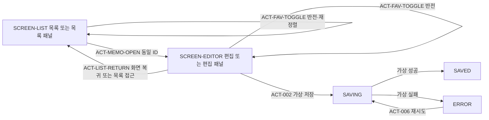

# EX-FEAT-001 메모·즐겨찾기 — CR-002/CR-003 합성 시험 요구사항

- 기능·작업·역할: FEAT-ROLE-001 / TASK-STAR-P / planning.
- 기능 폴더: docs/examples/role-execution. 디자인: design.md 및 prototype/.
- 변경: CR-002 즐겨찾기 정책을 보존하고 CR-003 앱·웹 디자인 타깃을 통합한다. 첫 실행·기준본을 취소하거나 삭제하지 않는다.
- 현재 제출: 반환 ISSUE-001에 대한 수정 검토 요청. planning_version=null. 실행기가 새 기준 번호를 결정하며 본 문서가 승인·DONE을 선언하지 않는다.
- 마지막 승인본: P-002 / TASK-ROLE-P2. D-002는 P-002에 연결된 APPROVED 버전이다. P-003 / TASK-STAR-P는 BLOCKED이며 보존한다. P-001/D-001은 SUPERSEDED다.
- 수정 입력: requirements.md SHA-256 f7b7f9df541e7179d0970f8451020f668bd98f27ae039f12ef99f35c12a83643. 기존 승인 P-002 SHA-256 6be0c3f09f27f92f3c285a785912eb92db6f6cda800c0c8ac01c553eac0d17ec는 제공된 기존 명세의 참조이며 이번 직접 열람으로 주장하지 않는다.
- 입력 Git 커밋: b802d18b068d4a213946a0c7f3b5dee77b6c6621. 새 산출물 커밋이 아니다.
- 버전 예외: 하네스 합성 예제에 한해 불변 콘텐츠 스냅샷을 사용한다. 실제 제품 인계의 Git 버전 요건 충족이나 사용자 제품 승인을 뜻하지 않는다.
- 후속: TASK-STAR-D / design / 패킷 관측 상태 TODO. TASK-STAR-DEV는 반환 이슈의 영향 작업이며 현재 상태·담당자 신원·외부 PR·추가 결정은 UNKNOWN이다.

## 문제·대상 사용자·목표

제품은 미선정이다. 짧은 생각을 기록하려는 사용자는 미승인 가설이며 조사·실제 사용자 정책 승인은 없다. 메모·즐겨찾기 예제로 기획→디자인→상위 Codex 검토→개발 입력 해석을 시험한다. CR-002의 즐겨찾기 정책과 CR-003의 앱용 HTML·반응형 웹 범위는 명시된 합성 시험 결정이다. 기존 메모 가설·가상 저장·미정 제품 정책을 유지한다.

## MVP 범위·제외 범위

- 포함: 샘플 메모 3개·빈 목록, 목록/편집, 즉시 즐겨찾기 반전·표시·안정 정렬·화면 이동 중 값 유지, 기존 가상 저장 성공·실패·재시도.
- 포함: 앱용 HTML 시뮬레이션 390×844, 반응형 웹 모바일 390×844 및 데스크톱 1280×900. 세 타깃의 상태·긴 콘텐츠·조작·시각 검토 명세.
- 포함: 공통 데이터 모델·상태 의미·토큰·즐겨찾기 컴포넌트 계약과 타깃별 표현·입력·포커스·내비게이션·스크롤 설계.
- 제외: 실제 제품·MVP 확정, 네이티브 앱 구현·실행·빌드, KMP 웹 빌드 채택·추가, API·실제 저장·새로고침 영속성, 검색·삭제 등 추가 기능.
- 기존 빈 본문 저장·공백 정규화·최대 길이·미저장 이탈·SAVING 중 본문 편집 정책은 UNKNOWN이다. 목록 이동이나 데스크톱 메모 선택으로 폐기·자동 저장 정책을 확정하지 않는다.
- KMP/Clean Architecture는 개발 입력 해석·계획 연습의 참조 구조에 한정한다. HTML 디자인 타깃을 실제 플랫폼 구현 채택으로 해석하지 않는다.

## 타깃·지원 범위

| 타깃 ID | 합성 디자인 범위·진입점 | 구성·입력·이동 | 지원·검증 경계 |
| --- | --- | --- | --- |
| app | prototype/app-favorites.html / 390×844 | 작은 화면의 목록↔상세 편집 전환, 터치용 조작과 화면 내 뒤로가기, 화면별 스크롤·복귀 포커스 설계 | 브라우저에서 렌더링하는 앱 모양 HTML. 네이티브 실행·시스템 뒤로가기·네이티브 키보드·플랫폼 접근성 검증은 NOT_RUN |
| web-mobile | prototype/web-favorites.html / 390×844 | 단일 열 목록↔편집, 터치 및 Tab/Enter/Space, 명시적 목록 복귀·포커스 설계 | 반응형 웹 시험. 실제 지원 브라우저·OS·버전·접근성 준수 수준은 UNKNOWN |
| web-desktop | prototype/web-favorites.html / 1280×900 | 목록+편집 분할 구성, 목록 선택으로 편집 대상 갱신, Tab 순서·Enter/Space·선택과 포커스·패널 스크롤 설계 | 모바일 화면을 단순 확대하지 않는다. 실제 지원 브라우저·OS·버전·접근성 준수 수준은 UNKNOWN |

이하 ALL은 app / web-mobile / web-desktop 세 타깃 모두를 뜻한다. 공통 데이터·상태 공유는 같은 실행 진입점 안의 목록/편집이 같은 메모 ID 상태를 참조하고 타깃 간 동일 계약을 사용한다는 뜻이다. 별도 앱/웹 문서 사이의 실시간 동기화·공유 저장소는 요구하지 않는다. 이는 페이지 메모리 한정 정책에 따른 INFERRED 해석이며 추가 CR 또는 실제 제품 전환 시 재검토한다.

## 요구사항별 근거·진행 판단

CONFIRMED는 제공된 명시적 합성 결정 또는 기존 명세의 근거 수준이며 실제 제품 승인이 아니다. 가정의 진행 판단은 근거 분류와 별개다.

| REQ ID | 요구사항 | 분류·출처 | 진행 판단·범위 |
| --- | --- | --- | --- |
| REQ-001 | 실제 제품 확정 없는 로컬 하네스 시험 | CONFIRMED / SRC-001,002,003,005 | 진행 가능 / 문서·시안·계획만 |
| REQ-002 | 본문 입력·가상 저장·진행·성공. 성공 첫 문장 `메모가 저장됐어요` 및 기존 비영속성 후속 안내 유지 | INFERRED 메모 가설·CONFIRMED 기존 합성 문구 / SRC-001 | 비어 있지 않은 본문 시험 진행 가능 |
| REQ-003 | 가상 실패 시 요청 본문·오류 유지 및 재시도 | INFERRED / SRC-001 | 동시 본문 편집 없는 시험 진행 가능 |
| REQ-004 | 빈 값·길이·실제 저장 보장·미저장 이탈·SAVING 중 본문 편집 | UNKNOWN / SRC-001 | 해당 분기 확인 전 차단 |
| REQ-005 | 화면·상태·크기·긴 콘텐츠·접근성의 별도 검토 | CONFIRMED / SRC-001,002,005 | 세 타깃 검토 준비 가능. 실행 결과는 별도 검토자 판단 |
| REQ-006 | 기존 합성 A·이전 artifacts 보존, 정확한 P→D 연결 | CONFIRMED / SRC-001,003,005 | 합성 결정 유지. 실제 선택으로 승격 금지 |
| REQ-FAV-001 | 기본 false, 목록·편집에서 즉시 반전 | CONFIRMED / SRC-002 | ALL 진행 가능 |
| REQ-FAV-002 | 목록에서 아이콘·텍스트·aria-pressed로 선택 여부 표시 | CONFIRMED / SRC-002 | ALL 진행 가능 |
| REQ-FAV-003 | 즐겨찾기 우선, 그룹 내 원래 생성 순서·동률 ID 오름차순, 해제 복귀 | CONFIRMED / SRC-002 | ALL 진행 가능 |
| REQ-FAV-004 | 동일 ID 목록↔편집 값 유지, 현재 페이지 메모리 한정 | CONFIRMED / SRC-002 | ALL 진행 가능. 새로고침 복구 보장 없음 |
| REQ-FAV-005 | 샘플 3개·빈 목록·기본/선택/해제·정렬 경계 제공 | CONFIRMED / SRC-002 | 검토 장치를 제품 영역과 구분하여 진행 |
| REQ-FAV-006 | 두 HTML 진입점·현재 index 링크·공유 토큰/컴포넌트·필수 DOM 계약 | CONFIRMED / SRC-002,005 | CR-003이 기존 단일 HTML 구성 요구를 확장·대체. 즐겨찾기 의미는 보존 |
| REQ-FAV-007 | 정확한 승인 입력을 읽고 개발 입력 확인·구현 계획만 작성 | CONFIRMED / SRC-002,003,005 | 승인 P/D·모든 자원·검토·아키텍처 입력 확보 전 개발 인계 차단 |
| REQ-TGT-001 | app / web-mobile / web-desktop 세 타깃과 지정 크기·구성 | CONFIRMED / SRC-005 | 합성 디자인만 진행 가능 |
| REQ-TGT-002 | 공통 상태 의미, 타깃별 입력·포커스·이동·스크롤 계약 | CONFIRMED / SRC-005 | 디자인이 가역적인 세부 사항과 이유를 명세하여 진행 |
| REQ-TGT-003 | 실제 지원 UNKNOWN·네이티브 NOT_RUN·타깃별 증거 및 전체 완료 경계 | CONFIRMED 범위·UNKNOWN 지원 / SRC-005 | HTML 검토 가능. 실제 지원 인증·플랫폼 완료 차단 |

기존 메모 가설 제안자는 기존 예제 기획이다. 샘플 문구·아이콘 형태·타깃별 구체적인 포커스 대상과 스크롤 방식은 디자인이 INFERRED 선택·근거·재검토 조건을 기록한다. 핵심 제품 정책을 대신 확정하지 않는다.

## REQ별 app/web 적용·공통/차이

| REQ ID | app | web-mobile | web-desktop | 공통 의미·플랫폼 차이 |
| --- | --- | --- | --- | --- |
| REQ-001 | 적용 | 적용 | 적용 | 모두 합성 시험 |
| REQ-002 | 편집 화면 | 단일 열 편집 | 편집 패널 | 본문·가상 저장 상태/문구 동일, 배치·포커스 차이 |
| REQ-003 | 오류·재시도 | 오류·재시도 | 편집 패널 오류·재시도 | 요청 본문 보존 동일 |
| REQ-004 | 미정 분기 차단 | 미정 분기 차단 | 메모 전환 포함 미정 분기 차단 | 실제 제품 정책 UNKNOWN 공통 |
| REQ-005 | 390×844 | 390×844 | 1280×900 | 상태·긴 콘텐츠 공통, 각 타깃 별도 검토 |
| REQ-006 | 적용 | 적용 | 적용 | 보존·버전 계약 동일 |
| REQ-FAV-001 | 목록·편집 | 목록·편집 | 목록·편집 패널 | 동일 ID 즉시 반전 |
| REQ-FAV-002 | 터치·HTML 접근성 | 터치·키보드 | 키보드·포인터 | 아이콘/텍스트/aria-pressed 동일, 표현·포커스 차이 |
| REQ-FAV-003 | 목록 재정렬 | 목록 재정렬 | 목록 패널再정렬 | 동일 정렬 키·결과 |
| REQ-FAV-004 | 화면 왕복 | 단일 열 왕복 | 목록 선택·편집 패널 전환 | 페이지 내 값 유지, 별도 문서 간 동기화 제외 |
| REQ-FAV-005 | 검토 장치 | 검토 장치 | 검토 장치 | 동일 샘플·빈 상태 의미、배치 차이 |
| REQ-FAV-006 | app-favorites.html | web-favorites.html | web-favorites.html | 공통 tokens.css·갤러리·DOM、app/web 스타일 분리 |
| REQ-FAV-007 | 앱 시뮬레이션 입력 | 웹 모바일入力 | 웹 데스크톱入力 | 계획에서 실제 KMP 채택과 구분 |
| REQ-TGT-001 | 작은 화면 전환 | 단일 열 | 분할 구성 | 지정 타깃·크기 공통 계약 |
| REQ-TGT-002 | 터치·화면 내 뒤로가기 | 터치·Tab/Enter/Space·복귀 | Tab/Enter/Space·패널 선택 | 입력·포커스·스크롤은 타깃별 설계 |
| REQ-TGT-003 | HTML/네이티브 분리 | 웹 지원 UNKNOWN | 웹 지원 UNKNOWN | 타깃별 증거、일부 PASS로 전체 완료 금지 |

## 사용자 흐름

| 흐름 ID | 조건·행동·결과 | REQ·AC |
| --- | --- | --- |
| FLOW-001 | 비어 있지 않은 본문 입력→가상 저장→SAVING→SAVED·기존 안내 | REQ-002 / AC-001,002 |
| FLOW-002 | 실패→ERROR·요청 본문 유지→재시도→SAVING→결과 | REQ-003 / AC-003 |
| FLOW-003 | 빈 값·공백 저장 | REQ-004 / AC-004 / Q-001 차단 |
| FLOW-004 | 이전 원본 보존→새 승인 P→TASK-STAR-D→세 타깃 D·별도 검토→개발 입력 해석 | REQ-006,FAV-007,TGT-003 / ROLE-P1-AC-006,F08,T03 |
| FLOW-FAV-001 | 목록 미선택 토글→true·표시·재정렬→다시 토글→false·원래 순서 | REQ-FAV-001~003 / F01~F03 |
| FLOW-FAV-002 | 동일 ID 목록 열기/선택→편집→토글→목록에서 동일 값·정렬 확인→재진입/재선택 | REQ-FAV-004,TGT-002 / F04,T02 |
| FLOW-FAV-003 | 별도 장치로 빈 목록→빈 상태→샘플 초기화→3개 false | REQ-FAV-005 / F05 |

app/web-mobile은 화면 전환, web-desktop은 분할 화면의 선택·포커스 이동으로 흐름을 구현한다. 본문 수정·저장 대기 없는 조건에서 왕복·대상 전환을 검토한다. 미저장 본문 또는 SAVING 중 이탈·메모 변경은 Q-004/005 차단 경로다.

## 업무 정책·타깃 적용

모든 POL은 ALL에 적용한다. 공통 의미와 타깃 차이를 각 행에 명시한다.

| POL ID | 공통 규칙·경계 | 근거·판단 | app/web 차이 |
| --- | --- | --- | --- |
| POL-001 | SAVING 중 중복 저장 차단 | REQ-002 / SRC-001 / INFERRED·시험 가능 | 화면/패널의 저장 조작에 동일 적용 |
| POL-002 | 실패 시 요청 본문 유지·재시도 | REQ-003 / SRC-001 / INFERRED·동시 편집 없는 시험 가능 | 오류 배치·포커스는 타깃별 |
| POL-003 | 빈 값·공백 허용·정규화 UNKNOWN | REQ-004 / Q-001 차단 | 차이 미확정 |
| POL-004 | 최대 길이·실제 저장 보장·미저장 이탈 UNKNOWN | REQ-004 / Q-002~004 차단 | 데스크톱의 다른 메모 선택도 이탈 검토 대상 |
| POL-005 | SAVING 중 본문 편집·이탈 일관성 UNKNOWN | REQ-004 / Q-005 차단 | 즐겨찾기와 별개. 화면/패널 전환으로 우회 확정 금지 |
| POL-006 | 성공·실패는 가상 응답. 성공 첫 문장과 기존 비영속성 후속 안내 함께 표시 | REQ-001,002 / SRC-001 | 동일 문구. 후속 안내 정확한 bytes는 D-002 원문 확보 필요 |
| POL-007 | 기존 A는 합성 시험 선택 | REQ-006 / SRC-001 | 제품 선택 아님. 세 타깃 확장 시 보존 관계 명시 |
| POL-FAV-001 | 초기 모두 false. 토글 1회마다 해당 ID만 즉시 반전 | REQ-FAV-001 / SRC-002 / 합성 확정 | 터치·클릭·키보드 모두 같은 의미 |
| POL-FAV-002 | 목록 아이콘·텍스트·aria-pressed 일치. 열기와 토글 분리. 편집 토글도 접근 가능한 이름·상태 제공 | REQ-FAV-002,006 / SRC-002 | 타깃별 표현 허용. 토글이 열기/선택을 발생시키지 않음 |
| POL-FAV-003 | true 우선→원래 생성 순서 오름차순→동률 ID 오름차순 | REQ-FAV-003 / SRC-002 | 모든 목록·목록 패널 동일. 토글/편집 시각을 키로 쓰지 않음 |
| POL-FAV-004 | 해제는 false 그룹의 원래 생성 순서 위치로 복귀 | REQ-FAV-003 / SRC-002 | 다른 true가 있으면 전체 초기 인덱스와 다를 수 있음 |
| POL-FAV-005 | 동일 실행의 목록·편집은 같은 ID의 페이지 메모리 값을 사용 | REQ-FAV-004 / SRC-002 | 화면/패널 이동은 초기화 금지. 새로고침·종료 이후 보장 없음 |
| POL-FAV-006 | 가상 저장 진행·성공·실패·재시도는 즐겨찾기 값을 변경하지 않음 | SRC-002에서 INFERRED / 시험 가능·추가 CR 시 재검토 | 모든 타깃 동일 |
| POL-FAV-007 | 빈 목록에 메모별 열기·토글 없음. 초기화 장치가 샘플 3개·false 복원 | SRC-002·초기화 결과 INFERRED / 시험 가능 | 데스크톱은 존재하지 않는 편집 대상·활성 토글도 남기지 않음. 구체적 빈 편집 표현은 디자인 재량 |
| POL-FAV-008 | 키보드 1회 활성화는 1회 반전. 재정렬 후 같은 메모를 식별하고 계속 조작 가능 | SRC-002·포커스 연속성 INFERRED / 시험 가능 | 웹 Tab/Enter/Space 검토. 앱 HTML 키보드 검토와 네이티브 검증 구분 |
| POL-TGT-001 | 공통 데이터·상태 의미·tokens.css·즐겨찾기 계약, app/web 표현 자원 분리 | REQ-TGT-001,002 / SRC-005 | app.css/web.css 등 별도 표현. 웹 모바일/데스크톱은 같은 HTML 허용 |
| POL-TGT-002 | 작은 화면은 목록↔편집, 데스크톱 웹은 목록+편집 분할 | REQ-TGT-001,002 / SRC-005 | 터치·뒤로가기 대체/복귀·Tab 순서·선택·포커스·스크롤을 디자인에 타깃별 명시 |
| POL-TGT-003 | 실제 OS/브라우저/버전·접근성 지원 및 KMP 웹 채택 UNKNOWN | REQ-TGT-003 / SRC-005 | 앱 HTML PASS도 네이티브 PASS 아님 |
| POL-TGT-004 | 세 타깃별 증거가 필요. 일부 타깃 PASS로 전체 완료 금지 | REQ-TGT-003 / SRC-005 | 합성 결함은 별도 앱 후보 한 타깃만 허용. 웹 증거 재사용은 동일성·영향 없음의 명시적 검토 근거 필요 |

정렬 데이터 제안(INFERRED, 기획): m-01,m-02,m-03의 생성 순서 키 1,2,2. ID가 동률을 결정한다. 표시 문구·아이콘은 디자인 재량이며 내부 키를 화면에 노출할 필요는 없다. 별도 문서 간 상태 비동기화 해석도 기획 제안이며 실제 공유 저장이 요구되면 재검토한다.

## 화면별 기능·행동·예외

기존 SCREEN-001의 편집 책임은 SCREEN-EDITOR로 계승한다. 아래 상태는 ALL에 적용하며 app/web-mobile은 화면, web-desktop은 패널로 표현한다.

| SCREEN / STATE | 기능·행동 | 정상·예외·빈 상태 | 연결 |
| --- | --- | --- | --- |
| SCREEN-LIST / LIST-DEFAULT | 샘플 3개·ACT-MEMO-OPEN·ACT-FAV-TOGGLE | false·생성 순서, 열기와 토글 독립 | F01,F02,F05,F06,T01 |
| SCREEN-LIST / LIST-MIXED | 선택 표시·반전·정렬 | 다른 메모 값 유지·해제 복귀. 모두 선택 상태도 상태 규칙에 포함 | F01~F03 |
| SCREEN-LIST / LIST-EMPTY | 빈 목록·샘플 복원 장치 | 읽을 수 있는 빈 상태·메모별 버튼 없음 | F05 |
| SCREEN-EDITOR / EMPTY | ACT-001 입력 | 빈 본문 표시만. 빈 저장 UNKNOWN | AC-001,004 / Q-001 |
| SCREEN-EDITOR / EDITING | ACT-001·ACT-002 | 비어 있지 않은 본문·긴 콘텐츠 | AC-001,002 |
| SCREEN-EDITOR / SAVING | ACT-003 중복 차단·ACT-004/005 결과 | 본문 동시 변경·이탈 차단 범위 유지. 즐겨찾기는 즉시 반전 | AC-002,003,F07 / Q-005 |
| SCREEN-EDITOR / SAVED | ACT-004 성공 | 정확한 첫 문장·기존 안내·즐겨찾기 유지 | AC-002,F07 |
| SCREEN-EDITOR / ERROR | ACT-006 재시도 | 요청 본문·오류 유지·긴 오류 접근 | AC-003,F07 |
| SCREEN-EDITOR / FAV-OFF,FAV-ON | ACT-FAV-TOGGLE·ACT-LIST-RETURN | 본문 상태와 독립, 동일 ID 값 유지 | F01,F04,F07,T02 |

Fxx는 EX-FEAT-001-AC-Fxx, Txx는 EX-FEAT-001-AC-Txx, AC-00x는 EX-FEAT-001-AC-00x다. 편집 다섯 본문 상태×즐겨찾기 양 값을 세 타깃 각각 검토한다. EMPTY에서 즐겨찾기는 존재하는 샘플 메모의 빈 본문 표시 시험이며 새 메모 생성 정책을 뜻하지 않는다. 미정 본문 정책은 실행하지 않는다.

모든 즐겨찾기 버튼은 data-action-id="ACT-FAV-TOGGLE"·data-memo-id를 갖는다. 목록/편집 루트는 각각 data-screen-id="SCREEN-LIST" / "SCREEN-EDITOR"를 유지한다. 열기 대상도 같은 ID로 대응한다. 데스크톱은 두 화면 루트가 동시에 표시될 수 있다. DOM 식별자만으로 접근성을 충족했다고 판단하지 않는다.

제품 화면·현재 컴포넌트 갤러리에 하네스 검증·NOT_RUN·PASS·작업/버전·실행 횟수 문구를 넣지 않는다. 가상 응답·초기화·빈 목록 검토 장치는 제품 영역과 구분하며 기존 비영속성 안내는 보존한다.

## 정상·실패·경계 시나리오

| SCN ID | 조건·기대 결과 | 연결 |
| --- | --- | --- |
| SCN-001 | `회의 메모` 입력→동일 문자열·EDITING | FLOW-001 / AC-001 |
| SCN-002 | 가상 저장→중복 차단→정확한 성공 첫 문장·기존 안내 | POL-001,006 / AC-002 |
| SCN-003 | 실패→본문·오류 유지→재시도→결과 | FLOW-002 / AC-003 |
| SCN-004 | 빈 값·공백 저장 기대 처리 UNKNOWN | POL-003 / AC-004 |
| SCN-005 | 세 타깃에서 긴 본문·오류·안내·조작·잘림 검토 | REQ-005 / ROLE-P1-AC-005 |
| SCN-FAV-001 | 초기 모두 false→m-02 선택→m-02,m-01,m-03 | F01~F03 |
| SCN-FAV-002 | 이어 m-03 선택→m-02,m-03,m-01. 생성 순서 동률을 ID로 결정 | F03 |
| SCN-FAV-003 | 이어 m-02 해제→m-03,m-01,m-02. 모두 해제→m-01,m-02,m-03 | F03 |
| SCN-FAV-004 | 목록→m-02 편집→토글→목록 확인→재진입. 동일 ID 값 일치 | F04 |
| SCN-FAV-005 | 빈 목록→빈 상태·메모별 버튼 없음→초기화→3개 false | F05 |
| SCN-FAV-006 | 토글은 열기/선택을 발생시키지 않으며 열기는 값을 바꾸지 않음 | F02,F04 |
| SCN-FAV-007 | 가상 저장 진행·성공·실패·재시도가 즐겨찾기를 초기화·롤백하지 않음 | F07 |
| SCN-FAV-008 | 키보드 연속 활성화→1회씩 반전·접근성 상태 일치·식별 가능한 포커스 | F02 / ROLE-P1-AC-005 |
| SCN-FAV-009 | 새로고침 이후 보장은 제외, 페이지 내 이동 유지와 구분 | F04 |
| SCN-TGT-001 | 앱 작은 화면·웹 모바일 단일 열·웹 데스크톱 분할을 각 진입점에서 확인 | T01 |
| SCN-TGT-002 | 본문 미수정·저장 대기 없음에서 앱 복귀·웹 모바일 복귀·데스크톱 메모 선택 및 키보드/패널 스크롤 확인 | T02 |
| SCN-TGT-003 | 타깃별 결과·캡처·누락과 HTML/네이티브 경계를 보고. 일부 PASS만으로 전체 완료하지 않음 | T03 |

## 수용 기준·타깃 적용

아래 실행 검증은 모두 NOT_RUN이다. 문서 제출과 실제 실행 PASS를 구분한다. 모든 AC의 적용 타깃은 ALL이며 구체적인 공통 의미·차이는 각 행에 명시한다.

| 고유 AC ID | 연결 | 관측 가능한 기대 결과·공통/차이 | 필수 여부 |
| --- | --- | --- | --- |
| EX-FEAT-001-AC-001 | REQ-002 / SCN-001 | 각 타깃 편집 화면/패널의 입력 문자열·EDITING 일치, SCREEN-001→SCREEN-EDITOR 추적 | 시험 필수 |
| EX-FEAT-001-AC-002 | REQ-002 / SCN-002 | 각 타깃 SAVING·중복 차단, 성공 첫 문장 정확히 `메모가 저장됐어요`, 기존 비영속성 후속 안내 원문 유지 | 시험 필수 |
| EX-FEAT-001-AC-003 | REQ-003 / SCN-003 | 각 타깃 실패 시 요청 본문·ERROR·재시도 유지 및 후속 결과 재현 | 시험 필수 |
| EX-FEAT-001-AC-004 | REQ-004 / SCN-004 | 빈 값·공백 저장 처리 UNKNOWN, 타깃별 임의 확정 금지 | 필수 여부 UNKNOWN / Q-001 차단 |
| ROLE-P1-AC-005 | REQ-005 / SCN-005,FAV-008 | app 390×844·web-mobile 390×844·web-desktop 1280×900 각각 목록 기본/혼합/해제/빈 상태·편집 다섯 상태×즐겨찾기 양 값, 긴 본문/오류/안내 검토. 조작·포커스·잘림·겹침·가독성·위계·일관성 별도 증거. 앱은 HTML 검토로 한정 | 시험 필수 |
| ROLE-P1-AC-006 | REQ-006 / FLOW-004 | 기존 합성 A·P-003 포함 불변 artifacts 보존, 정확한 새 P/D·CR-002/003·검토·인계 연결. 사용자 제품 승인으로 표현하지 않음 | 후속 실행 시험 필수 |
| EX-FEAT-001-AC-F01 | REQ-FAV-001 / SCN-FAV-001,004 | 각 타깃 초기 3개 false, 목록·편집 1회 활성화 시 해당 ID만 즉시 반전·재활성화 시 복귀 | 시험 필수 |
| EX-FEAT-001-AC-F02 | REQ-FAV-002,006 / SCN-FAV-006,008 | 목록 아이콘·텍스트·aria-pressed 일치, 토글/열기 분리·접근 가능한 이름. 터치/클릭/키보드 조작이 동일 반전 의미. 웹 Tab/Enter/Space와 앱 HTML 조작은 별도 기록 | 시험 필수 |
| EX-FEAT-001-AC-F03 | REQ-FAV-003 / SCN-FAV-001~003 | 세 타깃에서 제시한 정렬 결과·해제 복귀 동일 | 시험 필수 |
| EX-FEAT-001-AC-F04 | REQ-FAV-004 / SCN-FAV-004,006,009 | 본문 미수정·저장 대기 없는 화면 왕복 또는 데스크톱 패널 대상 전환에서 동일 ID 값 유지. 열기로 값 변경 없음. 페이지 메모리 한정 명시 | 시험 필수 |
| EX-FEAT-001-AC-F05 | REQ-FAV-005 / SCN-FAV-005 | 각 타깃 3개 샘플·빈 상태 접근, 빈 목록의 메모별 토글/열기 없음·샘플 복원. 데스크톱에 오래된 활성 편집 대상 잔존 없음 | 시험 필수 |
| EX-FEAT-001-AC-F06 | REQ-FAV-006 | index.html이 app-favorites.html/web-favorites.html 연결. 공통 tokens.css·컴포넌트 의미와 앱/웹 표현 갤러리, app/web 스타일 분리, system/design·DOM 계약 일치. 금지된 하네스 상태 문구 없음 | 시험 필수 |
| EX-FEAT-001-AC-F07 | REQ-002,003,FAV-004 / SCN-FAV-007 | 각 타깃 가상 저장 진행·성공·실패·재시도가 즐겨찾기 초기화/롤백을 일으키지 않으며 본문·기존 안내 보존 | 시험 필수 |
| EX-FEAT-001-AC-F08 | REQ-FAV-007 / FLOW-004 | 개발 입력에 승인 P/D·모든 세 타깃 자원·AC·검토·아키텍처 연결. 전체 input_receipt·REQ별 모듈/소유권/시험 계획 제출. HTML 타깃과 실제 KMP 채택 구분·구현/빌드 완료 주장 없음 | 후속 단계 필수 |
| EX-FEAT-001-AC-T01 | REQ-TGT-001 / SCN-TGT-001 | 앱 390×844 목록↔편집, 웹 390×844 단일 열, 웹 1280×900 목록+편집 분할. 웹 데스크톱이 단순 확대 구성이 아님 | 시험 필수 |
| EX-FEAT-001-AC-T02 | REQ-TGT-002 / SCN-TGT-002 | 디자인에 세 타깃 입력·포커스·내비게이션·스크롤 계약이 각각 존재하고 실제 HTML 조작과 일치. 웹 Tab/Enter/Space, 앱 터치용 조작·화면 내 복귀 확인. 네이티브 시스템 동작과 구분 | 시험 필수 |
| EX-FEAT-001-AC-T03 | REQ-TGT-003 / SCN-TGT-003 | target_artifacts에 app/web-mobile/web-desktop 각각 entry·screens·requirements. 동일 D에 모든 문서/자원 포함. 검토가 REQ→타깃→SCREEN/STATE/ACT→결과·캡처 연결, 타깃별 필수 결과 누락/FAIL/NOT_RUN 시 전체 완료 금지. 실제 지원 UNKNOWN·네이티브 NOT_RUN 명시 | 시험 필수 |

NOT_RUN 사유: 이번은 기획 제출이다. HTML 생성·브라우저·캡처·구조/동작/시각 검토·네이티브 실행·앱 구현·빌드를 수행하지 않았다. 기존 PASS를 변경 산출물에 자동 재사용하지 않는다. UNKNOWN 제품 분기는 삭제하거나 성공으로 집계하지 않는다. 기획 criteria 검토와 후속 UI 검증을 구분한다.

## 출처

| SRC ID | 제공 자료·SHA-256 | 근거·제한 |
| --- | --- | --- |
| SRC-001 | requirements.md / f7b7f9df541e7179d0970f8451020f668bd98f27ae039f12ef99f35c12a83643 | 직접 제공된 P-003 작업본. 기존 가설·UNKNOWN·ID·정책 보존 근거. 간접 P-002/D-002 원문을 새로 읽었다고 주장하지 않음 |
| SRC-002 | favorites-request.md / e6acf10b35a55cb9c17520746bbe4b9b620f3964af738eb71dc8deed1bfe7171 | CR-002 합성 즐겨찾기 정책·디자인 계약·개발 계획 범위 |
| SRC-003 | TASK-STAR-P 패킷 및 제공된 planning/requirements/operations/role-execution 정의 | 상태·제출·버전·인계 계약. 패킷 밖 PR·추가 결정은 UNKNOWN |
| SRC-004 | evidence/star-scope-return.json / 8fe8541544d4964d3c24c677c9ab556aaf255bf6a7b912d9e482c6abf1a5b525 | ISSUE-001의 지연 추가 요구 반환. 기존 실행의 자연 결함으로 집계하지 않음 |
| SRC-005 | targets-request.md / 09d14e02d97895b376d390ab68cc169b1150975e16fc4cc74ac1d3a594286c07 | CR-003의 세 타깃·공통/차이·지원 UNKNOWN·네이티브 NOT_RUN·검토 계약 |

D-002 원문은 이번 입력에 없다. 기존 후속 안내·디자인 bytes를 추정하지 않는다. 원본 사용자 메시지 ID는 제공되지 않아 UNKNOWN이며 출처 파일 해시를 실제 메시지 ID로 대체하지 않는다. 원문 수집·개입 연결 상태는 실행 관리자가 확인한다.

## 미결정·질문 묶음

| Q ID | 필요한 결정·추천/대안 | 차단 범위·담당 | 이번 처리·후속 |
| --- | --- | --- | --- |
| Q-001 | 빈 값·공백·정규화: 공백 거부 검토 / 허용, 입력 계약 영향 | 해당 저장 분기 / 기획→사용자 | UNKNOWN 유지, 합성 즐겨찾기 진행 가능 |
| Q-002 | 최대 길이: 목적 조사 후 결정 / 고정 한도, 입력 경계 영향 | 길이 제한 검증 / 기획·개발 | UNKNOWN, 긴 콘텐츠 시각 검토 가능 |
| Q-003 | 실제 저장·완료 보장: 보장 수준 합의 / 로컬 전용 | 실제 연동·영속성 / 기획·개발 | 명시적 범위 밖 |
| Q-004 | 미저장 이탈: 확인 / 자동 임시 저장·즉시 이탈, 본문 수명 영향 | 화면 복귀·데스크톱 메모 변경·복구 / 기획·개발 | 미수정 왕복만 시험 |
| Q-005 | SAVING 중 본문 편집·이탈: 비활성화 제안 확인 / 요청 본문 분리 | 동시 본문 변경·이탈 / 기획·개발 | UNKNOWN, 즐겨찾기와 별도 |
| Q-006 | 실제 대표 방향: 사용자 A/B 선택 / 수정안 | 실제 제품 확정 / 기획·디자인 | 기존 합성 A 보존 |
| Q-INPUT-001 | 기존 후속 안내·D-002 전체 자원: 불변 원문 제공 / 누락 확인 후 재개 | 원문 보존·디자인 인계 / 실행 관리자 | 메타데이터로 원문 수령을 주장하지 않음 |
| Q-INPUT-002 | 개발 승인 P/D·검토·아키텍처: 정확한 패킷 / 누락 역할 반환 | 개발 입력 해석 / 실행 관리자·개발 | 이번 기획 제출 차단 아님 |
| Q-TGT-001 | 실제 지원 OS·브라우저·버전·접근성 수준·KMP 웹 채택: 실제 제품 때 조사·결정 / 별도 지원 검증 작업 | 실제 제품 지원·플랫폼 구현 / 기획·디자인·개발 | UNKNOWN 유지. 합성 HTML 범위 밖이며 현재 결정 불필요 |

이번 허용된 합성 기획 범위의 미해결 핵심 결정은 없으므로 waiting 질문을 만들지 않는다. 응답 부재를 동의로 처리하지 않는다. 타깃별 가역적 세부는 디자인이 기록하고, 제품 정책 충돌은 기획으로 반환한다.

## 변경 영향·인계

| 변경·이유 | AC | 영향 산출물·작업·담당·PR | 재검토·재검증 |
| --- | --- | --- | --- |
| CR-002 즐겨찾기·목록 정책 보존 | F01~F05,F07 | 앱·웹 목록/편집·샘플·빈 상태 / TASK-STAR-D·TASK-STAR-DEV / design·development / PR UNKNOWN | 새 기준 의미 검토·세 타깃 회귀 |
| CR-003·ISSUE-001 타깃 누락 보완 | T01~T03 / ROLE-P1-AC-005 | requirements.md, design.md, prototype/app-favorites.html, web-favorites.html, app/web 표현 자원 / TASK-STAR-D·TASK-STAR-DEV | 모든 REQ/POL/AC 적용·구성/입력 차이·지원 UNKNOWN·네이티브 경계 재검토 |
| REQ-FAV-006 단일 앱 구성 확장 | F02,F06,T01 | index.html의 두 진입 링크·tokens.css·components.html·system.md 및 간접 자원 / design | 같은 D에 세 타깃 전체 자원 보관·공통 의미/스타일 분리 확인 |
| SCREEN-001→SCREEN-EDITOR 계승 및 데스크톱 패널 추가 | AC-001~003,F04,F07,T02 | 본문 다섯 상태·성공 안내·재시도·포커스·스크롤 / design | 기존 동작 회귀·미정 이탈 정책 우회 여부 확인 |
| 정확한 P→D→개발 입력 연결 | ROLE-P1-AC-006,F08,T03 | 실행 관리자·TASK-STAR-D·TASK-STAR-DEV / PR UNKNOWN | 승인 버전·전체 입력·검토 증거·아키텍처 연결 확인 |

ISSUE-001은 origin=late_user_requirement의 추가 범위 반영 반환이다. 본 수정은 재검토 기준에 대응하지만 이슈 상태를 직접 해결 처리하지 않는다. 검토자가 실제 새 명세의 모든 REQ 타깃 매핑·공통/차이·미정 지원·앱 HTML/네이티브 구분을 확인해야 한다.

이전 P/D 스냅샷·옛 파일은 수정하지 않는다. 디자인은 새 화면·스타일을 새 파일로 만들고 현재 index/components/system/design 고정 경로는 필요한 부분을 갱신한다. 공유 토큰은 기존 자원을 조사해 재사용·변경 근거를 기록한다. 모든 간접 자원을 files 또는 실제 동결 입력의 reuse에 포함한다.

다음 대상은 TASK-STAR-D다. 실행 관리자는 기획 검토 후 정확한 새 승인 P·CR-002/003·P-002/D-002 보존 원문·기존 합성 A 근거를 전달한다. 디자인은 두 HTML·공통 토큰/즐겨찾기 컴포넌트·앱/웹 상태 갤러리·표현 자원·타깃별 SCREEN/STATE/ACT/REQ/AC 대응을 같은 D로 제출한다. target_artifacts는 app / web-mobile / web-desktop 각각 entry·screens·requirements를 포함하며 웹 두 타깃은 같은 HTML을 참조할 수 있다.

상위 Codex가 실제 DOM·스타일·조작·캡처를 검토한다. 디자인의 자체 브라우저 확인 주장으로 대체하지 않는다. 합성 결함을 쓰면 별도 앱 후보 한 타깃에만 넣고 issue·보고서에 합성 시험용 결함으로 명시한다. 웹의 이전 근거 연결은 파일·간접 자원·검토 조건의 동등성과 비영향 근거를 검토자가 확인한 경우에만 가능하며 새 제출본의 PASS를 자동 상속하지 않는다.

개발은 승인된 정확한 P/D·세 타깃 자원·AC·검토·KMP/Clean Architecture 입력을 모두 읽고 input_receipt에 모든 입력 path/sha256·planning_version·design_version·acceptance_ids·해석을 기록한다. REQ별 제안 모듈·shared/platform 소유권·시험 계획만 작성한다. 앱/웹 디자인 범위와 실제 KMP 앱/웹 구현 채택을 구분한다. 제공 제약상 저장소에 앱 .kt/.kts 모듈은 없으며 제안 경로를 기존 코드로 표현하지 않는다. 앱 구현·웹 빌드 타깃 추가·KMP 빌드·플랫폼 검증은 수행하지 않으며 후속 NOT_RUN이다.

TASK-STAR-P-C1의 검토 근거는 REQ/POL/시나리오/AC, TASK-STAR-P-C2는 흐름·화면/상태·미결정·변경 영향이다. 이번은 수정본 검토 요청이다. 파일 반영·새 P 발급·불변 스냅샷·검토·승인·이슈 재검토·공식 인계는 실행기의 후속 처리다.
